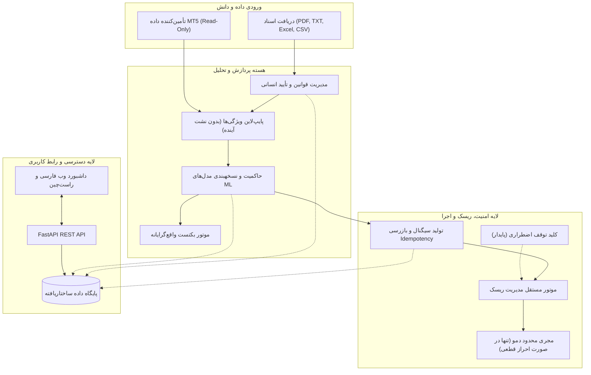

# سند معماری سامانه Adaptive Trader AI (Architecture Document)
**نسخه:** 1.0.0  
**وضعیت:** مصوب فاز مهندسی  
**هدف:** معماری ماژولار، ایمن، آزمون‌پذیر و قابل نگهداری برای سیستم معاملاتی تطبیقی

---

## ۱. نمای کلی سیستم و اصول بنیادین

سامانه **Adaptive Trader AI** با رویکرد «شکست امن» (Fail-Closed)، ماژولاریتی دقیق و تفکیک کامل لایه‌های تصمیم‌گیری، تحلیل و اجرا طراحی شده است.

### اصول کلیدی معماری (Core Architecture Principles):

1. **حالت اجرای تک‌جهته و شکست امن (Fail-Closed Execution):**
   - حالات مجاز به صورت سه‌گانه و اکیداً تعریف شده‌اند: `BACKTEST`، `SIGNAL_ONLY` (پیش‌فرض سیستم) و `DEMO_TRADING` (اختیاری و پیش‌فرض خاموش).
   - هیچ گزینه‌ای به نام `LIVE_TRADING` در کد، انوم، کانفیگ یا رابط کاربری وجود ندارد و نخواهد داشت.
2. **استقلال مطلق لایه ریسک از لایه پیش‌بینی:**
   - خروجی مدل صرفاً یک «سیگنال خام» یا «پیشنهاد تحلیلی» است و به تنهایی حق ارسال هیچ درخواستی را ندارد. فیلتر ریسک، حجم‌سنجی و مجوزهای امنیتی تنها تعیین‌کننده سرنوشت هر سیگنال هستند.
3. **تأیید صریح انسانی برای قوانین استخراج‌شده:**
   - هیچ گزاره یا قانون استخراج‌شده از اسناد (متنی یا مدل زبانی) به صورت خودکار به قانون اجرایی تبدیل نمی‌شود و تا زمان تایید صریح در پایگاه داده در وضعیت `pending` باقی می‌ماند.
4. **جلوگیری ساختاری از نشت اطلاعات آینده (Look-Ahead Bias Protection):**
   - پایپ‌لاین تولید ویژگی‌ها فقط به داده‌های قبل از نقطه تصمیم دسترسی دارد. برچسب‌گذاری حد سود/حد ضرر بر اساس داده‌های بعدی، به صورت محافظه‌کارانه و با جلوگیری از تداخل برخوردهای همزمان انجام می‌شود.
5. **کلید توقف اضطراری ماندگار (Persistent Emergency Stop):**
   - وضعیت توقف اضطراری در پایگاه داده ثبت می‌شود تا حتی در صورت راه‌اندازی مجدد سرور یا سرویس، وضعیت توقف پاک نشود.

---

## ۲. مشخصات و مسئولیت ماژول‌های سیستم

### ۲.۱. ماژول پیکربندی و امنیت (`backend/app/core/`)
- `config.py`: مدیریت تنظیمات با استفاده از `pydantic-settings`. بارگذاری امن متغیرهای محیطی از `.env` بدون لو رفتن مقادیر محرمانه.
- `security.py`: اعتبارسنجی وضعیت‌های اجرا (`ExecutionMode`)، بررسی اعتبارسنجی احراز دمو، جلوگیری از تغییرات مخرب.
- `logging.py`: لاگ‌گیری ساختاریافته با تفکیک لاگ‌های معاملاتی و حسابرسی امنیتی (Audit Log).

### ۲.۲. ماژول پایگاه داده و مدل‌ها (`backend/app/db/` و `backend/app/models/`)
- مدل‌های اصلی سیستم:
  - `Document`: ذخیره متاداده اسناد بارگذاری‌شده (شناسه، نام، نوع، منبع، چکیده، تاریخ).
  - `TradingRule`: مشخصات هر قانون (شناسه، نام، دسته‌بندی، شرایط، بازه نماد/تایم‌فریم، منبع سند، شماره صفحات، فرض‌ها و ابهامات، وضعیت تایید `pending`/`approved`/`rejected`).
  - `DatasetVersion`: ردیابی نسخه‌های داده خام و پردازش‌شده.
  - `MLModelRecord`: مشخصات نسخه‌های مدل، نوع الگوریتم، پارامترها، معیارهای ارزیابی زمانی (AUC, Precision, Brier Score, Calibration)، وضعیت مدل (`candidate`, `active`, `archived`, `rejected`).
  - `BacktestRun`: پارامترهای بکتست (اسپرد، کمیسیون، لغزش، دوره) و خروجی‌های آماری (Drawdown, Sharpe, Expectancy, WinRate).
  - `TradeSignal`: سیگنال‌های تولیدشده همراه با کلید Idempotency و شناسه یکتای زمان تصمیم.
  - `DemoOrder`: تاریخچه سفارش‌های دمو، قیمت درخواست و اجرا، دلایل لغو یا اجرا.
  - `EmergencyStopState`: آخرین وضعیت توقف اضطراری همراه با زمان و علت فعال‌سازی.
  - `AuditLog`: رخدادهای کلیدی امنیتی و پیکربندی.

### ۲.۳. ماژول دریافت اسناد و دانش (`backend/app/services/knowledge/`)
- دریافت انواع فایل‌ها: PDF، TXT، Markdown، Excel (`.xlsx`)، CSV.
- استخراج متن و متاداده بدون اجرای کدهای نامطمئن.
- استخراج قاعده‌محور (Rule-Based Extractor) و قابل توسعه با مدل زبانی.
- نگهداری دقیق شماره صفحه یا سطر منبع برای هر قانون استخراج‌شده.
- تفکیک گزاره‌های قطعی از حدسیات یا عبارات مبهم (نظیر «کندل خوب» یا «روند قوی») و ثبت پرسش شفاف برای تایید کاربر.

### ۲.۴. ماژول داده بازار و اتصال MT5 (`backend/app/services/market_data/`)
- واسط انتزاعی `IMarketDataProvider`: جداکننده منطق تحلیل از ابزار اتصال.
- پیاده‌سازی `MT5MarketDataProvider`:
  - مدیریت چرخه حیات اتصال (`initialize` و `shutdown`).
  - اعتبارسنجی اتصال شبکه و همگام‌سازی زمان سرور.
  - استخراج کندل‌های تاریخی و نرخ‌های زنده.
  - تشخیص داده‌های منقضی، ناقص یا نامعتبر (Gap & Staleness Detection).
  - متوقف‌سازی مسیر سفارش در صورت قطع اتصال یا ناهماهنگی زمانی.

### ۲.۵. ماژول مجموعه داده و مهندسی ویژگی‌ها (`backend/app/services/dataset/`)
- محاسبه اندیکاتورها و ویژگی‌های قیمتی (ATR, RSI, MA, Candle Shadows/Body, Return, Spread).
- برچسب‌گذاری افق زمانی بر اساس TP و SL با سناریوهای محافظه‌کارانه:
  - اگر در یک کندل هر دو سطح TP و SL لمس شوند، بدترین حالت (خروج با ضرر یا برچسب خنثی) ثبت می‌گردد تا از مثبت‌نمایی کاذب جلوگیری شود.
- تقسیم زمانی مستقل داده‌ها (Temporal Purged & Embargoed Train/Test Split) برای پیشگیری از اورفیت و نشت داده.

### ۲.۶. ماژول مدل یادگیری ماشین و حاکمیت مدل (`backend/app/services/ml/`)
- مدل‌های پایه‌ای سبک و قابل تفسیر: Logistic Regression و Random Forest.
- ارزیابی با پروتکل استاندارد زمانی (Time-Series Walk-Forward / Out-of-Time).
- ثبت کامل فراداده مدل‌ها، پارامترها و معیارهای کالیبراسیون در پایگاه داده.
- مدل‌های جدید در وضعیت `candidate` آموزش داده می‌شوند و مدل `active` تا زمان ارزیابی صریح و مقایسه‌ای جایگزین نمی‌شود.

### ۲.۷. ماژول بکتست واقع‌گرایانه (`backend/app/services/backtest/`)
- شبیه‌سازی گام‌به‌گام براساس رویدادها (Event-driven / Bar-by-bar).
- مدلسازی دقیق هزینه‌ها: اسپرد واقعی نماد، کمیسیون، لغزش قیمت (Slippage) و قوانین حداقل حجم و گام لات.
- محاسبه جامع شاخص‌های آماری: Gross/Net Profit, Max Drawdown, Recovery Factor, Expectancy, Profit Factor, Win/Loss Ratio.

### ۲.۸. ماژول مدیریت ریسک و توقف اضطراری (`backend/app/services/risk/`)
- محاسبه حجم سفارش (Position Sizing) بر مبنای فاصله SL، ارزش هر تیک (Tick Value)، ارز حساب و درصد ریسک مجاز (مثلاً ۱٪).
- اعمال سقف معاملات باز، سقف ضرر روزانه و فیلتر حداکثر اسپرد مجاز.
- اعتبارسنجی گام حجم و حداقل/حداکثر لات بروکر.
- کلید توقف اضطراری مستقل (`EmergencyStop`) با قابلیت فعال/غیرفعال‌سازی دستی و لاگینگ تغییر وضعیت.

### ۲.۹. ماژول تولید سیگنال و مجری دمو (`backend/app/services/signal/` و `execution/`)
- تولید سیگنال با وضعیت پیش‌فرض `SIGNAL_ONLY`.
- کلید جلوگیری از تکرار (Idempotency Key) بر پایه نماد، تایم‌فریم و شناسه کندل.
- مجری معاملات دمو (`DemoTradingExecutor`):
  - اعتبارسنجی پنج‌گانه پیش از ارسال:
    1. حالت سامانه حتماً `DEMO_TRADING` باشد.
    2. توقف اضطراری خاموش باشد.
    3. اتصال ترمینال و قیمت زنده معتبر باشند.
    4. کد حالت حساب کارگزاری `trade_mode == 0` (DEMO) باشد.
    5. سفارش از تمام فیلترهای ریسک عبور کرده باشد.
  - در غیر این صورت، عملیات فوراً Fail-Closed شده و دلیل عدم ارسال سفارش ثبت می‌گردد.

### ۲.۱۰. لایه واسط کاربری و API (`backend/app/api/` و `frontend/`)
- APIهای RESTful سریع با اعتبارسنجی ورودی توسط Pydantic.
- داشبورد تک‌صفحه‌ای فارسی با چیدمان راست‌چین (RTL)، تایپوگرافی مناسب، نمایش کارت‌های وضعیت زنده، جداول لاگ، مدیریت قوانین، اجرای بکتست و کلید برجسته توقف اضطراری.

---

## ۳. امنیت و پیشگیری از خطای انسانی (Security & Fail-Safe Matrix)

| سناریوی خطا یا ریسک | اقدام سیستم (Fail-Closed) | محل اعمال کنترل |
| :--- | :--- | :--- |
| تلاش برای فعال‌سازی حساب واقعی | مسدودسازی در سطح Enum و نبود کد سفارش زنده | `core/security.py` |
| قطع اتصال MT5 در حین پردازش | لغو فوری صدور سفارش و ثبت خطا در دیتابیس | `services/market_data/mt5_provider.py` |
| حساب غیر دمو (`trade_mode != 0`) | مسدودسازی ارسال سفارش و ثبت هشدار امنیتی | `services/execution/demo_executor.py` |
| قیمت دریافتی قدیمی یا اسپرد بالا | رد سیگنال توسط فیلتر ریسک | `services/risk/risk_engine.py` |
| فعال شدن کلید توقف اضطراری | رد تمام سیگنال‌های جدید و قفل دمو | `services/risk/circuit_breaker.py` |
| ریستارت سرور در وضعیت توقف | بازخوانی وضعیت فعال توقف از پایگاه داده | `services/risk/circuit_breaker.py` |
| تلاش برای ارسال سیگنال تکراری | رد بر اساس Idempotency Key در پایگاه داده | `services/signal/signal_engine.py` |
