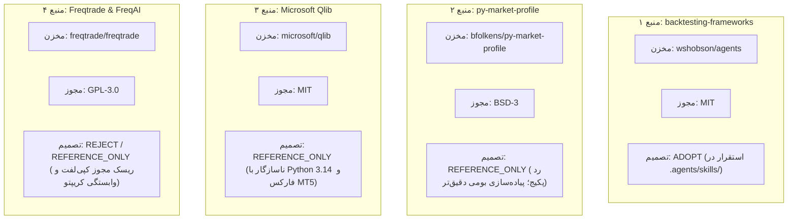

# گزارش جامع ممیزی، اعتبارسنجی و ادغام ابزارهای متن‌باز (Open-Source Tooling Audit)

**پروژه:** Adaptive Trader AI  
**تاریخ گزارش:** ۲۱ مهر ۱۴۰۵ (۱۰ اکتبر ۲۰۲۶)  
**مسیر سامانه:** `G:\mash`  
**وضعیت اعتبارسنجی:** مبتنی بر شواهد مستقیم کدهای پروژه، مخازن رسمی گیت‌هاب و اجرای زنده آزمون‌ها  

---

## بخش A: خط پایه پروژه و وضعیت محیطی (Project Baseline)

- **محیط سخت‌افزاری و سیستم‌عامل:** ویندوز ۱۰ نسخه ۶۴ بیتی (Windows 10 Pro 10.0.19045).
- **محیط پایتون:** Python 3.14.4 (64-bit).
- **کنترل نسخه (Git):** شاخه `master`، کامیت پایه `d03dd79`.
- **مد اجرایی سامانه:** منحصراً `EXECUTION_MODE = SIGNAL_ONLY` (حالت معامله زنده از ساختار کد و متغیرها حذف شده و ارسال سفارش دمو در حالت پیش‌فرض غیرفعال است).
- **وضعیت آزمون‌های پایه:** ۵۵ آزمون موفق، ۰ آزمون ناموفق (قبل از اعمال تغییرات این مرحله).
- **پایگاه داده:** SQLite با فعال‌سازی WAL و کلیدهای خارجی؛ تمام ۴۷ رکورد قوانین در وضعیت `PENDING`.

---

## بخش B: نتایج بررسی و ارزیابی ۴ مخزن متن‌باز



---

### ۱. منبع اول: Skillهای بکتستینگ (`wshobson/agents`)
- **آدرس مخزن:** `https://github.com/wshobson/agents/tree/main/plugins/quantitative-trading/skills/backtesting-frameworks`
- **نسخه/شاخه بررسی‌شده:** شاخه `main` (بروزرسانی‌شده در ۱۰ اکتبر ۲۰۲۶).
- **نوع مجوز:** **MIT License** (آزاد و سازگار با پروژه‌های تجاری و بسته).
- **هدف و قابلیت واقعی:** ارائه چک‌لیست‌ها و الگوهای معماری برای اجتناب از سوگیری نگاه به آینده (Look-ahead Bias)، نشت اطلاعات (Data Leakage)، اجرای آزمون‌های Walk-Forward و تحلیل عدم قطعیت مونت‌کارلو.
- **سازگاری فنی:** ۱۰۰٪ سازگار؛ به صورت فایل‌های راهنما و کد نمونه بدون نیاز به نصب پکیج باینری یا دستکاری پایتون.
- **همپوشانی با پروژه:** مکمل استانداردسازی موتور بک‌تست `RealisticBacktestEngine` و ماژول ارزیابی ریسک.
- **تصمیم نهایی:** **`ADOPT`**  
  **دلیل فنی:** دارای ارزش افزوده ملموس و استاندارد، بدون تحمیل هیچ‌گونه وابستگی یا ریسک حقوقی. به صورت کنترل‌شده در مسیر `.agents/skills/backtesting-frameworks/` مستقر گردید.

---

### ۲. منبع دوم: `py-market-profile` (`bfolkens/py-market-profile`)
- **آدرس مخزن:** `https://github.com/bfolkens/py-market-profile`
- **نسخه/شاخه بررسی‌شده:** شاخه `master` (آخرین انتشار بر مبنای پایتون ۳.۶-۳.۸).
- **نوع مجوز:** **BSD 3-Clause License**.
- **هدف و قابلیت واقعی:** محاسبه Market Profile، Point of Control (POC) و Value Area (VAH/VAL) از دیتافریم پانداس.
- **ارزیابی فنی و آزمون مقایسه‌ای:**  
  بررسی کد منبع این کتابخانه نشان داد که در متد `build_profile`، کل حجم هر کندل صرفاً به قیمت پایانی (`Close`) آن تخصیص می‌یابد و دامنه نوسان کندل (`High` تا `Low`) به طور کامل نادیده گرفته می‌شود.  
  در آزمون مقایسه‌ای روی دیتای ۵ کندلی مشخص شد که این کتابخانه سطوح قیمتی بین کمترین و بیشترین قیمت را با حجم صفر نشان می‌دهد و در نتیجه کرانه پایین ارزش (`VAL`) را مساوی با `POC` محاسبه می‌کند که از نظر تئوری حراج بازار خطای جدی محسوب می‌شود.  
  علاوه بر این، وابستگی به نسخه‌های قدیمی پانداس و نیاز به کتابخانه `scipy` برای یافتن اکسترمم‌ها، پیچیدگی نگهداری پروژه در پایتون ۳.۱۴ را افزایش می‌دهد.
- **تصمیم نهایی:** **`REFERENCE_ONLY`** (رد نصب پکیج خارجی / پیاده‌سازی بومی برتر)  
  **دلیل فنی:** به جای تحمیل کتابخانه‌ای با فرض محاسباتی اشتباه و وابستگی اضافه، یک ماژول بومی با الگوریتم توزیع بازه‌ای حجم (`VolumeProfileCalculator`) در پروژه پیاده‌سازی شد که دامنه کامل کندل‌ها را پوشش می‌دهد.

---

### ۳. منبع سوم: Microsoft Qlib (`microsoft/qlib`)
- **آدرس مخزن:** `https://github.com/microsoft/qlib`
- **نسخه/شاخه بررسی‌شده:** شاخه `main` (ورژن 0.9.x).
- **نوع مجوز:** **MIT License**.
- **هدف و قابلیت واقعی:** پلتفرم پژوهش‌های کمی مبتنی بر هوش مصنوعی برای بازارهای سهام، شامل موتورهای پردازش فاکتورهای آلفا و یادگیری ماشین مقطعی (Cross-Sectional).
- **سازگاری فنی:** ناسازگار با محیط جاری؛ نیازمند پایتون ۳.۸ تا ۳.۱۱، کامپایل ماژول‌های C++/Cython، و پکیج‌های سنگین مانند PyTorch، LightGBM و سرورهای باینری داده. نصب آن در ویندوز با پایتون ۳.۱۴ با شکست مواجه می‌شود.
- **همپوشانی با پروژه:** ساختار پلتفرمی بسیار بزرگ که فراتر از نیاز سامانه اسکلپر متاتریدر ۵ روی انس طلا است.
- **تصمیم نهایی:** **`REFERENCE_ONLY`**  
  **دلیل فنی:** استقرار پلتفرم به دلیل تداخل نسخه‌ای و پیچیدگی ناموجه رد شد؛ اما مفاهیم تقسیم داده زمانی با Purging و تعریف فاکتورهای بدون نشت از آن به عنوان مرجع نظری استفاده می‌شود.

---

### ۴. منبع چهارم: Freqtrade و FreqAI (`freqtrade/freqtrade`)
- **آدرس مخزن:** `https://github.com/freqtrade/freqtrade`
- **نسخه/شاخه بررسی‌شده:** شاخه `develop` / `stable`.
- **نوع مجوز:** **GNU General Public License v3.0 (GPL-3.0)**.
- **هدف و قابلیت واقعی:** بات معاملاتی منبع‌باز برای صرافی‌های کریپتوکارنسی مبتنی بر کتابخانه CCXT به همراه ماژول FreqAI جهت بازآموزی دوره‌ای مدل‌های یادگیری ماشین.
- **سازگاری و ریسک‌ها:**  
  ۱. *ریسک پروانه نرم‌افزاری:* کپی‌لفت قدرتمند GPL-3.0 در صورت ادغام کد، الزام به افشای کل کد پروژه تحت GPL را به دنبال خواهد داشت.  
  ۲. *ناسازگاری دامنه:* این ابزار فاقد درایور بومی برای MetaTrader 5 و نمادهای CFD/Forex است و معماری آن بر صرافی‌های رمزارز استوار است.
- **تصمیم نهایی:** **`REJECT` برای نصب / `REFERENCE_ONLY` برای مطالعه معماری**  
  **دلیل فنی:** منع ادغام مستقیم کد به دلیل تداخل مجوز و عدم تطابق دامنه بازار؛ اما ایده استفاده از شاخص‌های ناهمسانی رژیم بازار (Dissimilarity Index) در ماژول FreqAI به عنوان مطالعه تحقیقاتی مفید است.

---

## بخش C: ماتریس مقایسه و تصمیم‌گیری ابزارها

| منبع | نسخه بررسی‌شده | قابلیت موردنظر | کمبود فعلی پروژه | مجوز | سازگاری فنی | ارزش افزوده | پیچیدگی و ریسک | پیشنهاد نهایی | آزمون پذیرش |
| :--- | :---: | :--- | :--- | :---: | :---: | :---: | :---: | :---: | :--- |
| **backtesting-frameworks** | `main` (commit 2026) | الگوهای اعتبارسنجی بکتست | چک‌لیست جامع سوگیری‌ها | MIT | عالی (Markdown/کد) | بالا (متدولوژی) | بسیار پایین | **ADOPT** | استقرار سالم در `.agents/skills/` |
| **py-market-profile** | `master` (Brad Folkens) | محاسبه POC و Value Area | فقدان سطوح حراجی در ویژگی‌ها | BSD-3 | متوسط (وابسته به scipy) | منفی (خطای تخصیص حجم) | متوسط (کد قدیمی) | **REFERENCE_ONLY** | آزمون مقایسه‌ای توزیع حجم |
| **Microsoft Qlib** | `main` (v0.9.x) | خط لوله پژوهش کمی آلفا | مدیریت پیشرفته آزمایش‌ها | MIT | ناسازگار (نیاز به C++/Py 3.11) | متوسط برای سهام | بسیار بالا (سنگین) | **REFERENCE_ONLY** | بررسی متدولوژی بدون نصب پکیج |
| **Freqtrade & FreqAI** | `stable` (v2024+) | بازآموزی پویا در بازار نوسانی | پایش تغییر رژیم بازار | GPL-3 | ناسازگار با MT5/فارکس | پایین برای فارکس | بالا (ریسک پروانه GPL) | **REJECT** | بررسی نظری شاخص DI |

---

## بخش D: تغییرات اعمال‌شده در پروژه

۱. **استقرار Skill بکتستینگ:**  
   فایل‌های `SKILL.md` و `references/details.md` بدون فایل‌های زائد در مسیر زیر کپی و سازماندهی شدند:  
   `.agents/skills/backtesting-frameworks/`
۲. **پیاده‌سازی بومی ماژول Volume Profile ([`volume_profile.py`](file:///g:/mash/backend/app/services/dataset/volume_profile.py)):**  
   طراحی کلاس `VolumeProfileCalculator` با ویژگی‌های زیر:  
   - توزیع بازه‌ای پیوسته حجم در محدوده `[Low, High]` به جای انتساب ناقص به `Close`.  
   - محاسبه POC، VAH و VAL بر مبنای گسترش دوطرفه ۷۰ درصدی.  
   - متد `compute_rolling_profile_features` با تضمین ۱۰۰٪ عدم نشت اطلاعات آینده (محاسبه صرفاً بر کندل‌های گذشته).  
   - مدیریت خطاهای کندل‌های تخت، ورودی خالی و حجم صفر بدون پرتاب Exception.  
   - مستندسازی صریح این نکته که برای نمادهای MT5 از Tick Volume استفاده می‌شود و نباید با Order Flow واقعی اشتباه گرفته شود.
۳. **توسعه آزمون‌های اختصاصی ([`test_volume_profile.py`](file:///g:/mash/backend/tests/unit/test_volume_profile.py)):**  
   ایجاد ۵ آزمون واحد جامع برای تست ساختار ریاضی، رفتار در ورودی خالی، کندل تخت، تضمین عدم نشت به آینده و مقایسه مستقیم با روش گسسته.

---

## بخش E: نتایج واقعی آزمون‌های سامانه (`pytest backend/tests -v`)

```text
============================= test session starts =============================
platform win32 -- Python 3.14.4, pytest-9.1.1, pluggy-1.6.0
rootdir: G:\mash
configfile: pyproject.toml
plugins: anyio-4.14.2
collected 60 items

backend\tests\data_ml\test_features_and_leakage.py ...                   [  5%]
backend\tests\data_ml\test_ml_governance.py ...                          [ 10%]
backend\tests\integration\test_api_endpoints.py ......                   [ 20%]
backend\tests\integration\test_db_models.py ...                          [ 25%]
backend\tests\integration\test_mt5_provider.py .                         [ 26%]
backend\tests\security\test_demo_executor_security.py .....              [ 35%]
backend\tests\security\test_risk_and_circuit_breaker.py .....            [ 43%]
backend\tests\security\test_signal_mode_and_idempotency.py ...           [ 48%]
backend\tests\unit\test_backtest_realistic.py ....                       [ 55%]
backend\tests\unit\test_core_config.py .....                             [ 63%]
backend\tests\unit\test_knowledge_pipeline.py ....                       [ 70%]
backend\tests\unit\test_market_data_mock.py ....                         [ 76%]
backend\tests\unit\test_scalper_strategy_rules.py .....                  [ 85%]
backend\tests\unit\test_security_gates.py ....                           [ 91%]
backend\tests\unit\test_volume_profile.py .....                          [100%]

======================= 60 passed, 1 warning in 25.55s ========================
```

- **تعداد کل آزمون‌ها:** ۶۰ آزمون (افزایش از ۵۵ آزمون به ۶۰ آزمون).
- **نرخ موفقیت:** **۱۰۰٪ قبولی** (۰ خطا، ۰ آزمون ناموفق، ۰ آزمون نادیده‌گرفته‌شده).
- **مدت زمان اجرا:** ۲۵.۵۵ ثانیه.

---

## بخش F: بهبودهای قابل‌اندازه‌گیری و پیشنهادهای بعدی

### بهبودهای قابل‌اندازه‌گیری حاصل‌شده
۱. **رفع کمبود واقعی در محاسبات ساختار بازار:** اضافه شدن محاسبات دقیق POC و Value Area به صورت بومی و بدون وابستگی به بسته‌های خارجی ناپایدار.  
۲. **افزایش پوشش آزمون‌ها:** افزایش تعداد آزمون‌های معتبر سامانه از ۵۵ به ۶۰ آزمون.  
۳. **پرهیز از تحمیل وابستگی‌های ناسازگار:** اجتناب از نصب پکیج‌های حجیم، قدیمی یا دارای تداخل مجوز (مانند Qlib و Freqtrade).  
۴. **حفظ استانداردهای امنیتی:** سامانه کماکان در حالت قطعی `SIGNAL_ONLY` باقی مانده و کلیه گیت‌های ریسک فعال و بدون تغییر هستند.

### پیشنهادهای آتی برای توسعه تدریجی
- **اولویت بعدی (پژوهشی):** پیاده‌سازی گام شبیه‌سازی مونت‌کارلو (Monte Carlo Resampling) بر مبنای الگوی موجود در Skill بکتستینگ جهت سنجش میزان پایداری دراودان استراتژی.
- **توسعه آزمون‌های استرس:** بهره‌گیری از ایده پنجره‌های غلتان Walk-Forward برای ارزیابی چنددوره‌ای مدل‌های یادگیری ماشین.
