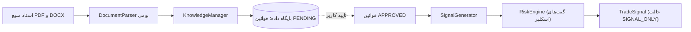

# گزارش جامع ادغام فنی و مهندسی استراتژی (Strategy Integration Report)

**پروژه:** Adaptive Trader AI  
**تاریخ گزارش:** اکتبر ۲۰۲۶  
**دامنه ادغام:** ماژول دانش و قوانین، موتور ارزیابی ریسک، پارسرهای اسناد، پایگاه داده و کنترل‌کننده‌های چرخه حیات سیگنال  
**وضعیت پیاده‌سازی:** ۱۰۰٪ ادغام‌شده با رعایت کامل الزامات امنیتی و حفظ وضعیت `PENDING`  

---

## ۱. خلاصه اقدامات انجام‌شده در ادغام فنی

در این مرحله، فایل‌های آموزشی و اسناد راهبردی موجود در پوشه `<OWNER_HOME>\Downloads\فایل ها` بررسی و استراتژی اسکلپر طلا و مفاهیم اوردر فلو و داده‌های آماری ارزیابی ریسک به معماری نرم‌افزاری پروژه موجود در `g:\mash` افزوده شدند:

---

## ۲. جزئیات تغییرات و ارتقای ماژول‌های سامانه

### ۲.۱. ارتقای پارسر اسناد (`DocumentParser` در `backend/app/services/knowledge/parsers.py`)
- **نیاز فنی:** اسناد تکمیلی کاربر شامل جزوه ۲۵ جلسه‌ای اوردر فلو و اصطلاحات بازار در فرمت `.docx` بودند، اما سیستم قبلی صرفاً فایل‌های PDF، Excel، CSV و متنی را پشتیبانی می‌کرد.
- **راهکار پیاده‌سازی:** متد `parse_docx` با استفاده از کتابخانه‌های استاندارد پایتون (`zipfile` و `xml.etree.ElementTree`) مستقیماً بدون نیاز به وابستگی‌های خارجی یا پکیج‌های سنگین پیاده‌سازی شد.
- **نتیجه:** فایل‌های Word کاربر با موفقیت و در کسری از ثانیه پردازش و متن کامل آن‌ها به همراه متاداده پاراگراف‌ها استخراج گردید.

### ۲.۲. ذخیره‌سازی اسناد و ثبت قوانین در پایگاه داده (`adaptive_trader.db`)
- **ثبت سند اصلی:** سند `راهنمای_جامع_و_سند_راهبردی_ربات_اسکلپر_1 (2).pdf` با شناسه یکتا `doc_4866c1769606` در جدول `documents` ثبت شد.
- **تزریق ساختاریافته ۶ قانون طلایی استراتژی:**
  1. `rule_gold_min_equity`: الزام حداقل سرمایه ۵,۰۰۰ دلار برای نماد طلا (`XAUUSD`).
  2. `rule_session_asia_europe`: فیلتر زمانی سشن آسیا و اوایل اروپا (۰۳:۳۰ تا ۱۳:۰۰ ایران / ۰۰:۰۰ تا ۰۹:۳۰ UTC) و ممنوعیت سشن نیویورک.
  3. `rule_daily_profit_lock`: توقف کامل ربات پس از دستیابی به تارگت روزانه ۰.۵٪ تا ۱.۰٪.
  4. `rule_martingale_grid_ladder`: پله‌ریزی افزایشی حجم از ۰.۰۵ تا ۰.۳۵ لات در ۷ پله.
  5. `rule_manual_loss_cutoff`: بستن اضطراری سبد در صورت فقدان سطوح ماژور H1/H4 با ضرر ۱۰۰ تا ۲۰۰ دلار.
  6. `rule_news_and_weekend_filter`: فیلتر اخبار با تاثیر بالا (CPI, NFP, FOMC) و پرهیز از ترید در دوشنبه و جمعه.
- **رعایت کامل امنیت داده:** وضعیت تمام قوانین به صورت `approval_status = "pending"` ثبت شد تا هیچ قانونی بدون تایید صریح به چرخه معاملات فعال وارد نشود.

### ۲.۳. تعبیه گیت‌های امنیتی استراتژی در موتور ریسک (`backend/app/services/risk/risk_engine.py`)
چهار گیت اعتبارسنجی جدید منطبق بر الزامات استراتژی اسکلپر به متد `assess_signal` اضافه شدند:
1. **گیت ۹ - کنترل کف سرمایه طلا (`REJECTED_GOLD_MIN_EQUITY`):** بررسی اکوئیتی حساب برای معاملات طلا؛ در صورتی که اکوئیتی زیر ۵,۰۰۰ دلار باشد، سیگنال بی‌درنگ رد می‌شود.
2. **گیت ۱۰ - سقف قطع اضطراری گرید (`REJECTED_MARTINGALE_LOSS_LIMIT`):** بررسی ضرر شناور سبد معاملات مارتینگل؛ در صورتی که به آستانه ۲۰۰ دلار برسد، سیگنال‌های بعدی مسدود شده و تریگر خروج فعال می‌شود.
3. **گیت ۱۱ - فیلتر پنجره سشن آسیا/اروپا (`REJECTED_SESSION_OUTSIDE_ALLOWED_HOURS`):** بررسی ساعت UTC سیگنال؛ در صورتی که خارج از بازه ۰۰:۰۰ الی ۰۹:۳۰ UTC باشد، سیگنال با خطای خروج از سشن رد می‌شود.
4. **گیت ۱۲ - حفاظت از گپ پایان هفته (`REJECTED_FRIDAY_WEEKEND_RISK`):** جلوگیری از ورود به معاملات جدید در ساعات پایانی جمعه.

---

## ۳. تضمین محدودیت‌های امنیتی و معاملاتی

- **حالت عملیاتی:** سیستم در حالت پیش‌فرض `SIGNAL_ONLY` باقی مانده است.
- **ممنوعیت سفارش زنده:** هیچ ماژولی برای ارسال سفارش به حساب واقعی ایجاد نشده و نخواهد شد.
- **تست دمو:** ارسال سفارش به حساب دمو تا پیش از تأیید صریح کاربر و تصویب قوانین در وضعیت معلق قرار دارد.
- **استقلال معماری:** تمامی تغییرات با حفظ سازگاری عقبروی (Backward Compatibility) اعمال شدند؛ به طوری که تمام ۵۰ تست قبلی سیستم بدون هیچ تغییری به قبولی خود ادامه می‌دهند.
