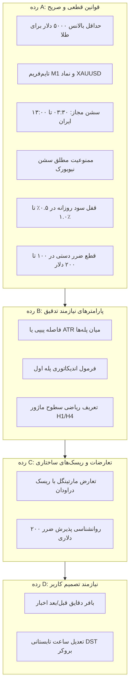

# مشخصات ساختاریافته و جامع استراتژی معاملاتی (Strategy Specification)

**پروژه:** Adaptive Trader AI  
**عنوان استراتژی:** ربات اسکلپر طلا و فارکس در تایم‌فریم ۱ دقیقه (Gold Scalper M1 Engine)  
**نوع استراتژی:** اسکلپ نوسان‌گیری با بازگشت به میانگین (Mean-Reversion Scalping) با مدیریت پله‌ای حجم و گیت‌های خروج اضطراری  
**وضعیت فعلی در پایگاه داده:** `PENDING` (غیرفعال در حالت عملیاتی - آماده ارزیابی تاریخی و تولید سیگنال)  

---

## ۱. معماری و اصول بنیادی استراتژی

استراتژی استخراج‌شده از سند راهبردی، بر مبنای بهره‌گیری از نوسانات با دامنه محدود در ساعات آرام بازار (سشن آسیا و ابتدای سشن اروپا) در تایم‌فریم ۱ دقیقه روی انس جهانی طلا (`XAUUSD`) و جفت‌ارزهای ماژور طراحی شده است. 

در مواجهه با امواج نامساعد مقطعی، سیستم از مکانیزم تعدیل پله‌ای حجم جهت انتقال میانگین قیمت ورود به نزدیکی قیمت جاری و خروج دسته‌جمعی با اولین اصلاح قیمت استفاده می‌کند. برای جلوگیری از فروپاشی حساب در روندهای شدید، چندین گیت سخت‌گیرانه زمانی، کنترلی و پذیرش ضرر محدود در معماری گنجانده شده است.

---

## ۲. دسته‌بندی قوانین استراتژی در ۴ رده استاندارد

---

### ۲.۱. رده A: قوانین صریح، قطعی و پیاده‌سازی‌شده در موتور ریسک (Category A - Explicit Rules)

این قوانین مستقیماً در متن سند تصریح شده‌اند و با قطعیت بالا در کدهای سامانه و جدول قوانین پیاده‌سازی شده‌اند:

| شناسه قانون | عنوان قانون | شرط و آستانه عددی صریح | منبع و صفحه | پیاده‌سازی در کد |
| :--- | :--- | :--- | :---: | :--- |
| `RULE_A_01` | **حداقل سرمایه طلا** | بالانس/اکوئیتی $\ge \$5,000$ (ایده‌آل: $\$10,000$ تا $\$20,000$). بالانس کمتر از ۵,۰۰۰ دلار اکیداً ممنوع. | صفحات ۴، ۱۱، ۱۵ | `RiskEngine.assess_signal` (گیت ۹) |
| `RULE_A_02` | **تایم‌فریم و نماد هدف** | نماد اصلی: `XAUUSD`، تایم‌فریم مبنا: `M1`، نماد فرعی: `EURUSD` با بالانس $\ge \$500$. | صفحات ۱، ۵، ۱۰ | اسکوپ قوانین در `trading_rules` |
| `RULE_A_03` | **پنجره سشن معاملاتی** | فقط سشن آسیا و ابتدای اروپا: ساعت ۰۳:۳۰ تا ۱۳:۰۰ به وقت ایران (۰۰:۰۰ تا ۰۹:۳۰ UTC). | صفحات ۱۴، ۱۵ | `RiskEngine.assess_signal` (گیت ۱۱) |
| `RULE_A_04` | **ممنوعیت سشن نیویورک** | معامله در سشن نیویورک و کشیده شدن پوزیشن‌های باز به سشن نیویورک و کلوز روزانه ممنوع است. | صفحات ۱۴، ۱۵ | رد سیگنال با خطای خروج از سشن |
| `RULE_A_05` | **تارگت سود روزانه** | کسب سود $0.5\%$ تا $1.0\%$ از سرمایه کل در طول روز. خاموشی قطعی ربات بلافاصله پس از لمس تارگت. | صفحات ۱۲، ۱۵ | جدول قوانین و مانیتورینگ اهداف |
| `RULE_A_06` | **پله‌ریزی حجم مارتینگل** | پله ۱: ۰.۰۵، پله ۲: ۰.۱۰، پله ۳: ۰.۱۵، پله ۴: ۰.۲۰، پله ۵: ۰.۲۵، پله ۶: ۰.۳۰، پله ۷: ۰.۳۵ لات. | صفحات ۹، ۱۲ | توالی حجم‌ها در متغیرهای سیستم |
| `RULE_A_07` | **پذیرش ضرر محدود** | اگر در بحران مارتینگل، سطح ماژوری در نزدیکی قیمت نباشد: بستن اجباری سبد با ضرر $100$ تا $200$ دلار. | صفحه ۱۴ | `RiskEngine.assess_signal` (گیت ۱۰) |
| `RULE_A_08` | **پرهیز از اخبار قرمز** | توقف فعالیت در زمان اخبار مهم آمریکا (CPI، NFP، نرخ بهره FOMC). | صفحات ۱۲، ۱۵ | فیلتر رویدادهای تقویم اقتصادی |
| `RULE_A_09` | **ریسک روزهای خاص** | پرهیز از معاملات در روزهای دوشنبه (گپ ابتدای هفته) و بستن پیش از کلوز جمعه. | صفحات ۱۲، ۱۵ | `RiskEngine.assess_signal` (گیت ۱۲) |
| `RULE_A_10` | **اسپرد کارگزار** | لزوم اسپرد ثابت و بسیار پایین (نظیر اسپرد ۱۸ در بروکر پیشنهادی سند). | صفحات ۱۴، ۱۵ | تطبیق با `MAX_ALLOWED_SPREAD_POINTS` |

---

### ۲.۲. رده B: قوانین نیازمند فرمول‌بندی و تدقیق پارامتری (Category B - Parameterization Needed)

این قوانین در سند به صورت کیفی یا با مثال بیان شده‌اند و نیازمند تعیین دقیق فرمول ریاضی هستند:

#### ۱. فاصله پیپی یا متغیر میان پله‌های حجم (Grid Step Distance)
- **شرح سند:** سند فقط مقادیر لات پله‌های ۱ تا ۷ را ارائه داده اما مشخص نکرده که فاصله باز شدن پله بعدی چند پیپ یا چه ضریبی از ATR است.
- **برداشت تحلیلی:** در طلای M1، نوسانات به شدت وابسته به ATR لحظه‌ای است.
- **پیشنهاد مهندسی:** استفاده از گرید پویا بر مبنای $1.5 \times ATR(14, M1)$ با حداقل کف ۲۵ پیپ (۲.۵ دلار طلا) به جای فاصله ثابت سنتی.

#### ۲. شرط تکنیکال ورود اولیه (Entry Trigger for Step 1)
- **شرح سند:** سند به عنوان راهنمای اکسپرت نوشته شده و تریگر درونی اکسپرت (شرط صدور پله اول) را قید نکرده است.
- **ارتباط با جزوه اوردر فلو و پرایس اکشن:** در جزوه اوردر فلو، تریگرهای عینی بر مبنای انحراف قیمت از VWAP، برخورد به کرانه‌های Value Area (VAH/VAL) و جذب سفارشات (Absorption) در تایم M1 تعریف شده‌اند.
- **پیشنهاد مهندسی:** ورود پله اول در جهت معکوس زمانی که RSI(14) به اشباع زیر ۳۰ یا بالای ۷۰ رسیده و قیمت از باند ۲ انحراف معیار VWAP خارج شده باشد.

#### ۳. تعریف الگوریتمی «سطح ماژور در چارت‌های ۱ ساعته و ۴ ساعته»
- **شرح سند:** سند می‌گوید اگر در تایم‌فریم H1 و H4 به یک حمایت یا مقاومت ماژور نزدیک بودید، معامله را نگه دارید، در غیر این صورت دستی ببندید.
- **نیاز به فرمول عینی:** مفهوم «نزدیکی» و «ماژور بودن» باید به صورت عددی برای ماشین تعریف شود.
- **پیشنهاد مهندسی:** سطوح ماژور به عنوان Swings با حداقل ۲۰ کندل در H1، یا سطوح هفتگی POC/VAH/VAL تعریف شوند؛ فاصله کمتر از $0.5 \times ATR(14, H1)$ نزدیکی تلقی شود.

---

### ۲.۳. رده C: تعارضات، تناقضات و ریسک‌های ساختاری (Category C - Conflicts & Structural Risks)

این بخش به تعارضات درون‌سندی و تعارض با یافته‌های آماری سند مستقل `KX_EIGHT_MYTHS.pdf` می‌پردازد:

#### ۱. تعارض مارتینگل افزایشی با بقای ریاضی سرمایه
- **تحلیل تعارض:** در صفحه ۹ سند، ادعا شده با بالانس ۲۰,۰۰۰ دلار و حجم اولیه ۰.۰۱ تا ۰.۰۵، «احتمال برخورد به استاپ بسیار پایین است». اما در سند مستقل `KX_EIGHT_MYTHS.pdf` (باورهای ۱ تا ۵) بر مبنای اندازه‌گیری روی میلیون‌ها معامله واقعی اثبات شده است که هرگونه سیستم با گرید یک‌طرفه در صورت وقوع روندهای پیش‌بینی‌نشده (Black Swan / Trend Day) نهایتاً منجر به کال‌مارجین می‌شود.
- **راهکار حل تعارض:** گیت سخت‌گیرانه پذیرش ضرر در ۱۰۰ تا ۲۰۰ دلار (سقف حداکثر ۲٪ از حساب ۱۰,۰۰۰ دلاری) که در صفحه ۱۴ سند آمده، باید به عنوان یک «گیت سخت‌افزاری» در سطح کد فعال باشد تا رفتار مارتینگل مهار گردد.

#### ۲. تعارض روانشناسی معامله‌گر با بستن دستی معامله
- **تحلیل تعارض:** سند اسکلپر بستن دستی ضرر در ۱۰۰ تا ۲۰۰ دلار را به تصمیم انسانی کاربر در تایم H1/H4 واگذار کرده است. تجربه عملیاتی نشان می‌دهد که معامله‌گران خرد در فاز بحران به دلیل تعصب شناختی از بستن پوزیشن ضررده امتناع می‌کنند و حساب نابود می‌شود.
- **راهکار حل تعارض:** سامانه Adaptive Trader AI باید این مداخله را به صورت خودکار (Automated Circuit Breaker) در سقف ۲۰۰ دلار اجرا کند تا وابستگی به خطای روانی انسان حذف شود.

---

### ۲.۴. رده D: نیازمند تصمیم‌گیری و تأیید صریح کاربر (Category D - User Decision Required)

مواردی که انتخاب میان گزینه‌ها به عنوان تصمیم تجاری کاربر باید ثبت گردد:

۱. **انتخاب مدل فاصله پله‌های گرید:** آیا فاصله پله‌ها ثابت باشد (مثلاً ۳ دلار / ۳۰ پیپ طلا) یا پویا بر مبنای ATR تایم ۱ دقیقه؟
۲. **تعیین بافر زمانی فیلتر اخبار:** خروج از بازار چند دقیقه قبل و بعد از اخبار قرمز اعمال شود؟ (گزینه پیشنهادی: ۳۰ دقیقه قبل تا ۴۵ دقیقه بعد از خبر).
۳. **تطبیق ساعت بروکر با UTC در تغییرات ساعت تابستانی (DST):** ساعت کاری کارگزار مورد استفاده نسبت به سرور نیویورک تنظیم شود یا زمان محلی تهران؟
